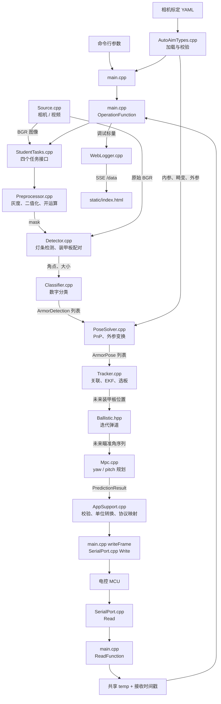

# 各项功能对应的脚本

| 功能 | 当前实际实现 | 入口 / 关键函数 |
|---|---|---|
| 取流 | [vision/src/Source.cpp](/home/krazyk/Desktop/RMVtraining/vision/src/Source.cpp) | `get_pic()` → `Source::read()`；支持视频、UVC、海康 |
| 参数入口 | [main.cpp](/home/krazyk/Desktop/RMVtraining/main.cpp:84)、[StudentTasks.cpp](/home/krazyk/Desktop/RMVtraining/student/src/StudentTasks.cpp:20) | `parseOptions()`；文件顶部 `k...` 常量；三个配置构造函数 |
| 相机参数文件 | [config/camera.yaml.example](/home/krazyk/Desktop/RMVtraining/config/camera.yaml.example) | 内参、畸变、相机到云台外参、分辨率、标定误差 |
| 预处理 | [vision/src/Preprocessor.cpp](/home/krazyk/Desktop/RMVtraining/vision/src/Preprocessor.cpp:7) | `Preprocessor::run()` |
| 配置校验 | [src/AutoAimTypes.cpp](/home/krazyk/Desktop/RMVtraining/src/AutoAimTypes.cpp:26) | `loadCameraParameters()` → `CameraParameters::valid()` |
| 坐标、单位定义 | [include/AutoAimTypes.hpp](/home/krazyk/Desktop/RMVtraining/include/AutoAimTypes.hpp)、[Communication.hpp](/home/krazyk/Desktop/RMVtraining/serialPort/include/Communication.hpp) | 算法结构体及串口协议字段 |
| 坐标变换 | [vision/src/PoseSolver.cpp](/home/krazyk/Desktop/RMVtraining/vision/src/PoseSolver.cpp:21) | `PoseSolver::solve()` |
| 单位转换、协议映射 | [src/AppSupport.cpp](/home/krazyk/Desktop/RMVtraining/src/AppSupport.cpp:74) | `applyPrediction()` |
| 识别灯条 | [vision/src/Detector.cpp](/home/krazyk/Desktop/RMVtraining/vision/src/Detector.cpp:10) | `Detector::find_lights()` |
| 识别数字 | [vision/src/Classifier.cpp](/home/krazyk/Desktop/RMVtraining/vision/src/Classifier.cpp:39) | `Classifier::classify()` → `extract()` → ONNX推理 |
| 识别装甲板 | [vision/src/Detector.cpp](/home/krazyk/Desktop/RMVtraining/vision/src/Detector.cpp:47) | `Detector::match()`；由 `armor_detect()` 组合数字分类 |
| PnP | [vision/src/PoseSolver.cpp](/home/krazyk/Desktop/RMVtraining/vision/src/PoseSolver.cpp:21) | `solve()` → `solvePnPGeneric(..., SOLVEPNP_IPPE)` |
| EKF | [tracking/src/Tracker.cpp](/home/krazyk/Desktop/RMVtraining/tracking/src/Tracker.cpp:102) | `Tracker::update()` → 预测、关联、`correct()` |
| 迭代弹道 | [tracking/include/Ballistic.hpp](/home/krazyk/Desktop/RMVtraining/tracking/include/Ballistic.hpp)、[StudentTasks.cpp](/home/krazyk/Desktop/RMVtraining/student/src/StudentTasks.cpp:170) | `ballistic_angles()`；`ekf_predict()` 内的 `aim` lambda |
| MPC | [tracking/src/Mpc.cpp](/home/krazyk/Desktop/RMVtraining/tracking/src/Mpc.cpp:30) | `AxisMpc::build()`、`AxisMpc::solve()` |

| 层级 | 参数内容 |
|---|---|
| 命令行 | 串口设备、波特率、标定文件路径、可选 Web 端口 |
| YAML | 相机内参、畸变、固定外参、标定分辨率 |
| `StudentTasks.cpp` 常量及模块头文件默认值 | 取流来源、曝光、阈值、模型路径、尺寸、跟踪噪声、弹速、MPC参数 |

# 脚本间数据流



其中，StudentTasks.cpp 是算法模块的连接层。更准确的数据类型流向为：
```
cv::Mat BGR
  → cv::Mat mask
  → vector<Light>
  → vector<ArmorDetection>：角点、大小、数字编号、置信度
  → vector<ArmorPose>：三维位置、装甲板朝向、重投影误差
  → vector<TrackObs>
  → Tracker：11维状态及协方差
  → 未来装甲板位置
  → BallisticSolution：yaw、pitch、飞行时间
  → yaw_ref / pitch_ref：未来角度、角速度
  → MpcPlan：未来状态和角加速度序列
  → PredictionResult
  → Translator：64字节通信帧
```

串口输入单独提供：
```
status → 判断模式和敌方颜色
yaw / pitch → MPC当前角度、差分估计角速度
bias → 瞄准预测时间偏置
roll → 保存到GimbalState，但当前算法未实际用于姿态变换
```

构建关系见 [CMakeLists.txt](/home/krazyk/Desktop/RMVtraining/CMakeLists.txt)：
```
rmv_training
  ├─ main.cpp
  ├─ training_core
  │    ├─ src/AppSupport.cpp
  │    ├─ src/AutoAimTypes.cpp
  │    └─ student/src/StudentTasks.cpp
  ├─ vision：5个视觉源文件
  ├─ tracking：Tracker.cpp、Mpc.cpp
  ├─ serialPort
  └─ web_debug：可选
```
  