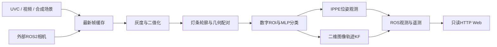

**算法与系统职责分开，C++核心可以脱离ROS节点进行单元测试。**

`perception_core`包含Preprocessor、Detector、Classifier、PoseSolver、ImageTracker和Source。它们的接口只使用C++标准类型/OpenCV类型。ROS节点负责参数、线程、时间戳、发布和JPEG调试图；Python桥负责订阅与HTTP。

**坐标、时间与数据契约**

图像格式统一为BGR8；亮度灰度转换是BGR2GRAY。角点顺序为左上、右上、右下、左下；物点在平面z=0，x向右、y向下。PnP观测坐标采用相机光学系：x右、y下、z前。三维位置为米，JSON角度为弧度，页面转换为度。

观测yaw是水平相机方位、pitch向上为正。它们不包含相机到云台外参、惯性系变换、重力或延迟补偿，不属于执行机构目标值。相机移动时图像速度混合了相机运动和物体运动，不可解释成整车世界速度。

UVC时间戳记录在read返回时，不代表硬件曝光中心；外部ROS相机使用消息原始时间戳。若设备驱动不支持硬件时间戳，需要在测试记录中说明。采集FPS按收到帧数统计，处理FPS按完成帧数统计，Web编码独立限频。输出配置60FPS只是请求值。

CameraInfo为plumb_bob/rational_polynomial时使用其K/D。当前不处理ROI、binning、fisheye和rectified P矩阵；需由外部驱动发布与图像匹配的普通针孔内参。标定不符时保留检测并停用PnP。

**检测与分类的能力边界**

传统配对依赖可见灯条，受遮挡、反光、曝光、侧向视角影响。大小板使用灯条间距/长度几何比值，强侧视下可能误判；目前没有基于时间或双尺寸PnP联合评分的尺寸判别。分类网络沿用参考权重，未在用户数据上重新训练或验证准确率。

分类不过阈值的候选继续可视化，便于诊断，但带有`accepted=false`标记。所有候选同等输出，不进行击打目标优先级排序。轨迹关联采用按距离排序的一对一贪心分配，不是匈牙利算法；近距离交叉同类目标仍可能交换ID。

**跟踪的实际含义**

ImageTracker使用二维匀速KF，估计像素中心和像素速度，处理短暂缺测和时间间隔；不会把多块板关联为一辆车，不估计车体半径、角速度或世界速度。它不是EKF，不提供弹道运动预测。时间倒退或大间隔会清空轨迹，新轨迹重建x/P。数值非法的轨迹会移除。

**线程和关闭**

采集线程只写最新帧；处理线程独占分类网络和滤波器。覆盖计数衡量节点内部丢弃的旧帧，不包含相机或DDS已经丢弃的数据。Web桥使用独立线程和数据锁，不直接进入图像算法。

UVC read是否及时返回由驱动决定；当前没有跨驱动统一的硬读超时/断线自动重连。输入停止后Web按接收时间显示过期。视频默认不循环，可通过YAML启用循环。不会在输入断开后继续伪造新帧。

**参考关系**

采用rm_auto_aim的传统检测与MLP输入约定，参考CVRM2021的图像/数据分开显示方式。原始CVRM2021桥依赖UMT和pybind11共享对象；本工程用ROS话题替代该连接，不兼容其运行时对象接口。没有声称移植了原弹道/串口/EKF模块。

OpenCV的IPPE接口用于共面点并可取得多个姿态候选，见[官方PnP文档](https://docs.opencv.org/4.x/d5/d1f/calib3d_solvePnP.html)。原参考MLP及许可保留在本工作空间中。
