# RM_AA 当前源码流程框架与参数说明

> 2026-09-19 修复更新：本文原记录的两处 include 拼接、TF 调用多余反斜杠、弹道候选时间 NaN 问题已修复；枪口偏移参数也已改为显式构造 Eigen 向量。MSVC Release 独立控制核心构建成功，14/14 项测试通过。下文涉及这些问题的描述为修复前记录，不再表示当前状态；ROS2 节点仍未完成构建验证。详见 [验证记录](validation.md)。

分析日期：2026-09-18。分析根目录：`D:\RM_Auto_Aiming\RM_AA`。以当前 `src` 中的源码、launch 和 YAML 为准；不把参考项目的实现、历史测试日志或旧 README 当作当前实现。

本文是静态源码分析，未执行本次 ROS2 构建或实物运行。只新增本文，不修改算法。下文控制流程图表达源码组织和设计调用关系；当前控制链路存在第 11 节列出的编译与运行阻塞，不能理解为已经正常运行。

## 1. 项目整体：三个包、两条处理链、一条调试支路

| 包 | 主要职责 | 产物 / 运行入口 |
|---|---|---|
| `rm_aa_vision` | 取图、预处理、灯条与装甲板检测、数字分类、PnP、二维图像跟踪 | `perception_core` 库；`perception_node`、`perception_cli` |
| `rm_aa_control` | 固定系观测转换、9 维 EKF、选板、未来位置与弹道计算、双轴 MPC | `camera_control_core` 库；`control_node`；`mock_gimbal.py` |
| `rm_aa_bringup` | 感知启动配置、ROS 到 HTTP 的调试桥、网页 | `perception.launch.py`、`debug_web.py`、Web 静态文件 |

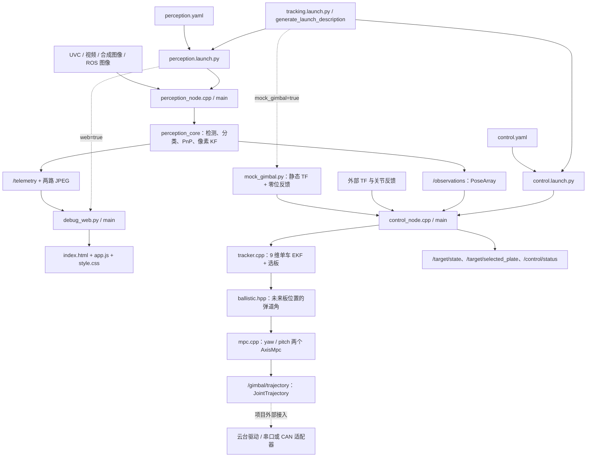

关键区别：视觉 `ImageTracker` 是 4 维像素 KF，控制 `Tracker` 才是 9 维整车 EKF。二者并非前后串接：控制端直接订阅 PnP 位姿，不接收像素 KF 的状态或 ID。

## 2. 启动、构建和文件关系

### 2.1 实际程序入口

| 文件（均相对于项目根目录） | 入口 | 做什么 |
|---|---|---|
| `src/rm_aa_vision/src/perception_node.cpp` | `main()` → `PerceptionNode()` → `rclcpp::spin()` | 在线视觉主程序；创建模块、线程、订阅与发布 |
| `src/rm_aa_vision/src/perception_cli.cpp` | `main()` | 单图/合成图离线检测分类，输出图片和 JSON |
| `src/rm_aa_control/src/control_node.cpp` | `main()` → `ControlNode()` → `rclcpp::spin()` | 在线控制主程序；观测、反馈、定时规划三个入口 |
| `src/rm_aa_bringup/scripts/debug_web.py` | `main()` | 启动 ROS 接收线程与 HTTP 服务 |
| `src/rm_aa_control/scripts/mock_gimbal.py` | `main()` → `MockGimbal()` → `spin()` | 接口演示用固定 TF、50 Hz 零角度/零速度反馈 |
| `src/rm_aa_bringup/launch/perception.launch.py` | `generate_launch_description()` | 启动感知和可选 Web |
| `src/rm_aa_bringup/launch/control.launch.py` | `generate_launch_description()` | 启动控制节点 |
| `src/rm_aa_bringup/launch/tracking.launch.py` | `generate_launch_description()` | 包含前两项启动文件，按参数开启 mock |

其他算法 `.cpp` 没有独立 `main()`，由节点调用其类方法；不能把每个文件都理解成一个 ROS 节点。

### 2.2 头文件与实现文件

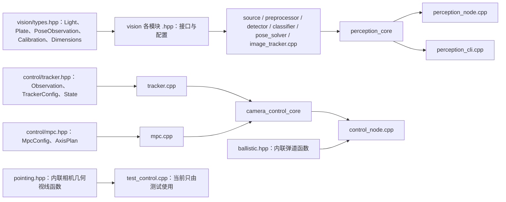

构建文件的职责：

- 视觉 `CMakeLists.txt` 把六个算法实现编成 `perception_core`，再链接节点、CLI 和测试；安装 ONNX 与标签。
- 控制 `CMakeLists.txt` 把 `tracker.cpp`、`mpc.cpp` 编成 `camera_control_core`；弹道与几何指向函数为头文件内联实现。`RM_AA_CONTROL_STANDALONE=ON` 只构建算法库与测试，不编译 ROS 节点。
- bringup 的 `CMakeLists.txt` 安装 `config/launch/web` 和 Python HTTP 桥。
- 三个 `package.xml` 声明各自 ROS 包身份与依赖，不包含算法逻辑。
- `tools/standalone/CMakeLists.txt` 提供视觉算法、CLI 和测试的非 ROS 构建入口，不包含控制节点。

## 3. 视觉主程序：线程、函数入口与数据流

源码：[perception_node.cpp](../src/rm_aa_vision/src/perception_node.cpp)。

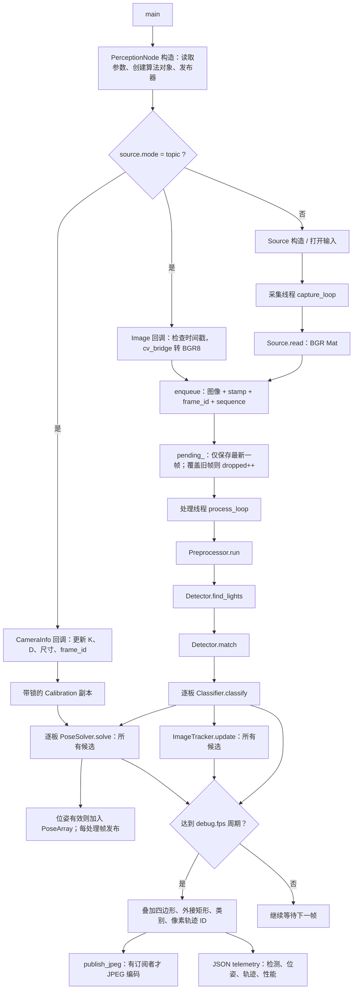

### 3.1 主文件各函数

| 函数 / 回调 | 输入 → 输出 / 副作用 |
|---|---|
| `PerceptionNode()` | ROS 参数 → 模块实例、发布器、订阅器、采集/处理线程 |
| `validate_distortion()` | 畸变系数 → 检查数量与有限性；非法时异常 |
| `CameraInfo` 回调 | 针孔相机信息 → 更新标定；不符合支持条件则禁用标定 |
| `Image` 回调 | ROS 图像 → BGR8 clone → `enqueue()` |
| `enqueue()` | 图像、时间和坐标系 → 覆盖最新帧缓存、更新统计并唤醒处理线程 |
| `capture_loop()` | `Source.read()` → 在读取返回后取节点当前时间、入队；非实时源按名义帧率节拍运行 |
| `process_loop()` | 最新帧 → mask、灯条、候选板、类别、位姿、像素轨迹、ROS 输出 |
| `publish_jpeg()` | Mat 与原始图像头 → JPEG `CompressedImage` |
| 析构函数 | 停止标记 → 唤醒等待 → 等待线程退出 |

`pending_` 是一个最新帧邮箱，不是持续增长的 FIFO。`dropped` 只表示这个邮箱被覆盖的次数，不包括相机驱动或 DDS 内部的丢帧。

相机模式的时间戳在 `read()` 返回后生成，不是曝光时间；topic 模式保留外部图像时间戳。相机/视频读取失败后退出采集循环，没有自动重连。合成图像是二维绘制演示，并非严格的多板旋转车体仿真。

### 3.2 每个视觉算法文件的入口

| `.cpp` 文件 | 主要入口与内部调用 | 输入 → 输出 |
|---|---|---|
| `source.cpp` | `Source()`；`read()` → `synthetic_frame()` 或 `VideoCapture.read()`；`nominal_fps()` | 输入模式/设备 → BGR 图像 |
| `preprocessor.cpp` | `Preprocessor()`；`run()` → `cvtColor` → `threshold` → 可选 `morphologyEx` | BGR8 → 单通道二值 mask |
| `detector.cpp` | `Detector()`；`find_lights()`；`match()` | BGR+mask → `vector<Light>` → `vector<Plate>` |
| `classifier.cpp` | `Classifier()` 加载 ONNX；`classify()` → `extract()` → DNN → softmax | 原图+板四角 → 原地更新类别、置信度、有效标记 |
| `pose_solver.cpp` | `PoseSolver()`；`solve()` → `object_points()` → IPPE → 重投影选解 | 板角点+标定+尺寸 → `optional<PoseObservation>` |
| `image_tracker.cpp` | `ImageTracker()`；`update()` → 预测、关联、校正/建轨；`reset()` | 所有板中心+时间 → 像素轨迹向量 |
| `perception_node.cpp` | `main()`；采集/订阅、处理和发布 | 上述模块的在线组织层 |
| `perception_cli.cpp` | `main()` | 单张输入或合成图 → 检测分类 JSON+叠加图片 |

对应同名 `.hpp` 声明配置、接口和成员。`types.hpp` 统一数据结构：`Light` 保存灯条端点/中心/宽长/颜色；`Plate` 保存板四角、中心、大小板、颜色与分类字段；`PoseObservation` 保存 rvec/tvec、重投影误差与相机方位角。角点顺序统一为 **左上 TL → 右上 TR → 右下 BR → 左下 BL**。

CLI 虽包含 PnP 相关头文件，但当前 `main()` 没有调用 PnP 或跟踪，也不读取 ROS YAML。因此 CLI 成功只证明其实际执行的检测分类链路。

## 4. 检测、数字分类和 PnP 的函数级流程

### 4.1 预处理和装甲板几何检测

源码：[preprocessor.cpp](../src/rm_aa_vision/src/preprocessor.cpp)、[detector.cpp](../src/rm_aa_vision/src/detector.cpp)。

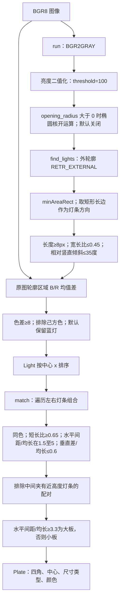

这里的板宽高比采用“两个灯条中心的水平 x 间距 / 平均灯长”，不是两中心欧氏距离。`own_color=red` 表示己方为红，检测蓝。矩形框由主节点调试叠加阶段绘制：既画四角多边形，也画轴对齐 `boundingRect`；Detector 本身返回几何数据。

### 4.2 数字识别

源码：[classifier.cpp](../src/rm_aa_vision/src/classifier.cpp)。

```mermaid
flowchart LR
  Input["classify：BGR + Plate"] --> Extract["extract：按 BL/TL/TR/BR 建立透视映射"]
  Extract --> Warp["小板32×28 / 大板54×28"]
  Warp --> Crop["中心数字区20×28"]
  Crop --> Bin["灰度 + Otsu"]
  Bin --> Blob["blobFromImage：归一化1/255"]
  Blob --> Net["OpenCV DNN CPU / mlp.onnx"]
  Net --> Softmax["检查输出，稳定 softmax"]
  Softmax --> Label["最大概率标签 + confidence"]
  Label --> Accept["confidence≥0.7 且 label 非 negative"]
  Accept --> Update["写回 Plate.classification_valid"]
```

标签顺序是 `1, 2, 3, 4, 5, outpost, guard, base, negative`。透视映射中灯条上下端落在模板 y=7/19，保留数字区域上下空间。分类函数更新 `Plate`，不删除低置信度候选，也没有大小板与数字类别一致性筛选。

**关键数据行为：`classification_valid=false` 仍进入像素 KF 和 PnP。** 当前 `accepted` 是分类标记，不等于“控制端禁止使用此候选”。

### 4.3 IPPE 位姿

源码：[pose_solver.cpp](../src/rm_aa_vision/src/pose_solver.cpp)。

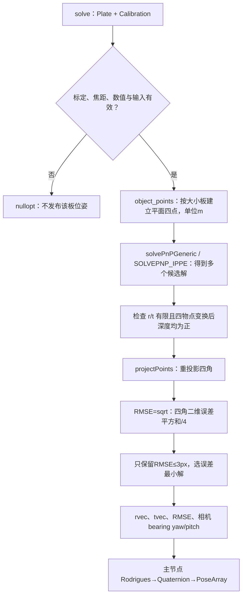

板局部物点为 `(-w/2,-h/2,0)、(w/2,-h/2,0)、(w/2,h/2,0)、(-w/2,h/2,0)`。相机系 X 向右、Y 向下、Z 向前；tvec 单位米。

观测方位角：`bearing_yaw=atan2(tx,tz)`，`bearing_pitch=-atan2(ty,sqrt(tx²+tz²))`。这两个角只是相机视线角，不能直接当作经过外参和重力补偿的云台命令。

主节点还检查标定与当前图像尺寸；topic 模式检查 CameraInfo 坐标系匹配。默认真实相机/视频标定无效，仍可检测但没有 PnP 位姿；synthetic 模式显式改用虚构有效内参。topic 可由有效 CameraInfo 提供标定。

## 5. 两种跟踪器及其状态

### 5.1 图像端：`image_tracker.cpp`

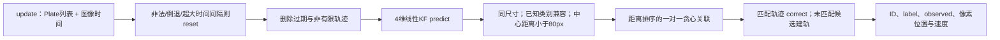

状态 `x_img=[u,v,du/dt,dv/dt]`，观测 `[u,v]`，单位 px 与 px/s。过程噪声使用加速度模型系数 2500；测量协方差为 `4I`；新轨迹协方差对角线为 `[25,25,10000,10000]`。这些数值写在代码中，不在 YAML。

时间异常 `reset()` 清空状态与协方差，并增加 `reset_count`；ID 计数不随 reset 重用。未匹配旧轨迹短时保留预测，`observed=false`；超过超时删除。这个轨迹 ID 只用于感知遥测与叠加，不发送给控制端。

### 5.2 控制端：9 维整车 EKF

源码：[tracker.hpp](../src/rm_aa_control/include/rm_aa_control/tracker.hpp)、[tracker.cpp](../src/rm_aa_control/src/tracker.cpp)。

状态严格按代码顺序：

`x=[cx,vx,cy,vy,cz,vz,theta,omega,r]ᵀ`

| 下标 | 状态 | 物理意义 | 单位 |
|---|---|---|---|
| 0、2、4 | cx、cy、cz | 固定坐标系中板环中心位置；cz 是模型所有板共用的高度 | m |
| 1、3、5 | vx、vy、vz | 中心三轴平移速度 | m/s |
| 6 | theta | 第 0 块板朝内法向在固定系 XY 平面的相位 | rad |
| 7 | omega | 上述相位的角速度 | rad/s |
| 8 | r | 板中心到板环中心的半径，参与估计 | m |

它不估计加速度状态、第二半径、相邻板高度差，也不是多车跟踪器。默认假设单车、4 板等角度间隔、同高度、同半径。`theta` 是板面相位，不必等于车体行驶方向。

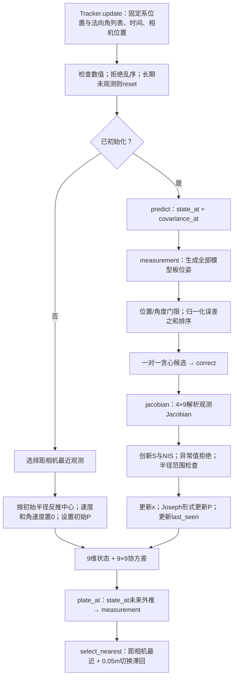

函数对应关系：

| 函数 | 作用 |
|---|---|
| `update()` | 一帧观测入口：初始化或预测后多观测关联/校正 |
| `state_at(t)` | 返回指定时刻的匀速、匀角速外推状态；不修改内部滤波状态 |
| `covariance_at(t)` | 计算 `F P Fᵀ+Q`；不修改内部状态 |
| `predict(t)` | 将上述外推结果写回内部状态与时间 |
| `measurement(x,i)` | 从车体状态计算第 i 块板的三维位置和法向角 |
| `jacobian(i)` | 观测函数对 9 维状态的解析导数 |
| `correct(o,i)` | 角度残差归一化、NIS 门控、EKF/Joseph 更新 |
| `plate_at(i,t)` | `measurement(state_at(t),i)`，用于未来板位置预测 |
| `select_nearest(t,camera)` | 在全部模型板中选最近板，加距离滞回稳定索引 |
| `valid(t)` / `reset()` | 检查时效 / 使跟踪失效并清除选板索引 |
| `wrap()` | 将角度归一化到跨 ±π 可处理的区间 |

平移和相位预测：`c(t+dt)=c(t)+v·dt`，`theta(t+dt)=theta(t)+omega·dt`，速度和半径保持。

第 i 块板模型：

```text
alpha_i = theta + 2*pi*i/N
plate_i = [cx-r*cos(alpha_i), cy-r*sin(alpha_i), cz]
measurement_i = [plate_i.x, plate_i.y, plate_i.z, alpha_i]
```

测量是 4 维 `[板x,板y,板z,朝内法向角]`；位置来自 PnP+TF，法向角来自 PnP 四元数的局部 +Z 经 TF 旋转后在 XY 平面的方向，**不是 PnP 的 bearing_yaw**。

关联成本为 `位置距离/0.5 + 角度距离/1.0`，先通过两个门限再排序。一次成功校正占用一个观测和一个板索引；一帧可顺序校正多块板。初始化只用最近观测。模型半径过程噪声 `Qrr=1e-5*dt` 为代码常量。

最近选板以当前预测时刻的板中心到相机光心距离为依据；新板至少近 `switch_margin_m` 才切换。它不按数字优先级、可见性、正对程度或命中概率打分；预测窗内固定板索引，下个控制周期再选。

## 6. 控制节点内部：三路入口汇合为规划

源码：[control_node.cpp](../src/rm_aa_control/src/control_node.cpp)。本节描述设计调用流，现有源码阻塞见第 11 节。

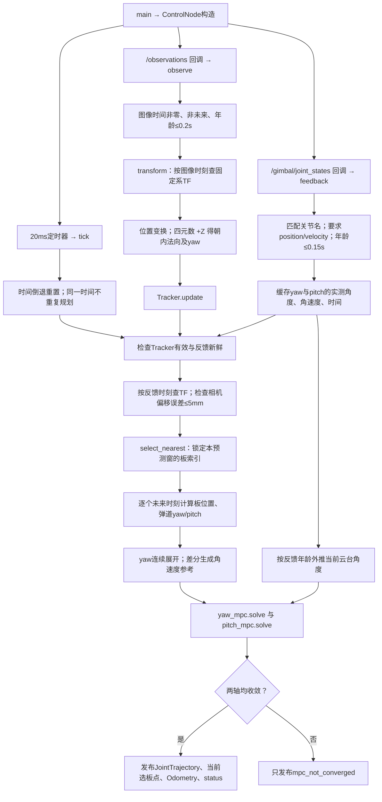

| 方法 | 输入与作用 |
|---|---|
| `positive()` | 声明并校验必须为正的数值参数 |
| `transform(to,from,time)` | TF 查询 → `Eigen::Isometry3d`，检查四元数与有限值 |
| `observe()` | PoseArray → 固定系 `vector<Observation>` → EKF；法向水平分量太小则跳过 |
| `feedback()` | JointState → `yaw_=[角度,角速度]`、`pitch_=[角度,角速度]` 和反馈时间 |
| `tick()` | 有效性判断、选板、弹道参考、双轴 MPC、结果发布 |
| `tick()` 内 `angles(stamp)` lambda | 给定未来命令时刻 → 迭代飞行时间后的 yaw/pitch |
| `angles()` 内 `direct(fire_stamp)` lambda | 固定板索引在指定时刻的位置 → 基座坐标 → 弹道解 |
| `publish_status()` | 状态文字 → `/control/status` |

控制器不使用 Web 的低频 JSON。观测与反馈为 SensorDataQoS、深度 5；视觉发布观测为 SensorDataQoS、深度 1。观测 TF 使用图像时间，规划 TF 使用最新有效反馈时间，避免直接查询尚无变换的“现在”。预测窗内保持该基座变换不动，未预测本车基座的未来运动。

状态包含 `waiting_for_target`、`waiting_for_feedback`、`clock_reset`、`camera_tf_mismatch`、`mpc_not_converged`、`planning_unavailable` 和成功时的板索引/半径。失败时不发布新轨迹；当前选板点和整车状态也只随成功规划发布。

## 7. 预计击打位置、弹道和 MPC

### 7.1 未来位置到底怎么算

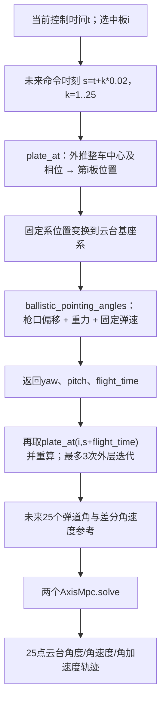

给定最新滤波时刻 `t0`、预计发射时刻 `s` 和飞行时间 `tau`，预计板位置按：

```text
delta = s + tau - t0
c_hit = [cx,cy,cz] + [vx,vy,vz] * delta
alpha_hit = theta + omega * delta + 2*pi*i/N
p_hit = c_hit - [r*cos(alpha_hit), r*sin(alpha_hit), 0]
```

源码先以 `tau=0` 的板位置求出飞行时间，再用 `s+tau` 重算；外层最多 3 次，飞行时间差小于 `1e-6 s` 提前停止。达到次数上限时没有额外不收敛拒绝逻辑。

**`/target/selected_plate` 发布的是 `plate_at(i,t)` 当前预测点，不是 `p_hit`。** 真正考虑飞行时间的预测点是 `tick()` 中生成参考的临时变量，没有独立话题输出。

### 7.2 `ballistic.hpp` 的内部函数

入口 `ballistic_pointing_angles(target,pitch_to_barrel,bullet_speed,gravity)`，输出 `BallisticSolution{angles,flight_time}`。设计流程：

1. 从目标几何方向初始化 yaw/pitch。
2. 按 `Rz(yaw)*Ry(-pitch)` 旋转枪口偏移，求当前枪口位置。
3. 由目标与枪口的水平距离、高度差建立无空气阻力抛体方程。
4. 解出两个俯仰候选，意图选择正飞行时间中较短的一支。
5. 更新 yaw/pitch，迭代到偏移与角度一致；内部最多 12 次、角度变化阈值 `1e-9`。

重力按基座 -Z 处理，因此当前计算要求基座 Z 与重力方向一致；未对任意基座 roll/pitch 做重力矢量变换。未实现空气阻力、风偏或弹速估计。当前候选时间初始化为 NaN 的缺陷会使第 4 步失败，详见第 11 节。

`pointing.hpp` 的 `camera_pointing_angles()` 则解相机光心带偏移时的几何视线方向，不含弹道；当前控制节点未调用它，只在测试中使用。

### 7.3 `mpc.cpp` 内部调用

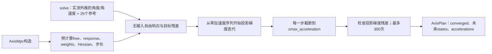

每轴状态为 `[angle,rate]`，控制量为角加速度 `u`。离散动力学：

```text
angle_next = angle + rate*dt + 0.5*u*dt²
rate_next  = rate + u*dt
J = Σ [40*(angle-reference_angle)²
       + 1*(rate-reference_rate)² + 0.1*u²]
```

每周期分别求 yaw 与 pitch；只对角加速度做硬约束。没有机械角度/角速度硬约束、两轴耦合约束或热启动。N=25、dt=0.02，预测窗为 0.5 s，输出第一个点位于未来 0.02 s。

### 7.4 已有与缺失的延迟处理

| 项目 | 当前源码行为 |
|---|---|
| 从图像观测时刻到未来时刻 | EKF 使用时间戳外推目标状态 |
| 图像处理拥塞 | 最新帧覆盖旧帧，避免内部队列积累 |
| 反馈延迟 | 用实测角速度把关节角外推至本次控制时间 |
| 弹丸飞行时间 | 设计上迭代未来板位置与 flight_time，目前受弹道缺陷阻塞 |
| 外部硬件曝光时间 | 仅 topic 模式可沿用驱动时间；UVC 本地模式没有 |
| 固定发射机构延迟 / 串口延迟 | 没有独立配置或估计项 |
| MPC 求解耗时后的再补偿 | 轨迹头使用 tick 开始时间，没有完成时再对齐 |
| 本车基座未来位姿 | 未外推，预测窗使用反馈时刻 TF |

## 8. 数据接口、坐标和单位

### 8.1 进程间话题

以下是无 namespace 时的默认全名；部分发布名是相对名，改变 namespace 后会变化。

| 话题 | 类型 | 生产者 → 消费者 | 内容 / 节拍 |
|---|---|---|---|
| `/camera/image_raw` | `sensor_msgs/Image` | 外部相机 → 视觉 | 仅 topic 模式；使用原始时间戳 |
| `/camera/camera_info` | `sensor_msgs/CameraInfo` | 外部标定源 → 视觉 | K、D、尺寸、坐标系 |
| `/observations` | `geometry_msgs/PoseArray` | 视觉 → 控制 | 每个处理帧的有效 PnP 位姿，可为空 |
| `/telemetry` | `std_msgs/String` JSON | 视觉 → Web桥 | 默认最多10 Hz；检测、分类、位姿、像素轨迹和性能 |
| `/debug/image/compressed` | `sensor_msgs/CompressedImage` | 视觉 → Web桥 | 标注图 JPEG |
| `/debug/mask/compressed` | 同上 | 视觉 → Web桥 | 二值图 JPEG，仅用于显示 |
| `/gimbal/joint_states` | `sensor_msgs/JointState` | 实际驱动或mock → 控制 | 有时间戳的两轴角度与角速度 |
| `/gimbal/trajectory` | `trajectory_msgs/JointTrajectory` | 控制 → 外部驱动 | 理论50 Hz重新规划，每次25点 |
| `/target/state` | `nav_msgs/Odometry` | 控制 → 外部诊断 | 中心位置、速度、相位、角速度与协方差；无半径字段 |
| `/target/selected_plate` | `geometry_msgs/PointStamped` | 控制 → 外部诊断 | 选中板当前预测位置 |
| `/control/status` | `std_msgs/String` | 控制 → 外部诊断 | 状态或板索引与半径 |
| `/tf`、`/tf_static` | TF | 外部系统或mock → 控制 | 观测和基座变换 |
| `/gimbal/bullet_speed` | YAML 中的预留名 | **当前未创建订阅** | 不能认为实时弹速已生效 |

`PoseArray` 不包含类别、置信度、板 ID、车 ID、板尺寸或位姿协方差。视觉 JSON 中有 `pose_array_index` 帮助对应候选与位姿数组，但控制节点不订阅 JSON。视觉候选列表索引、像素轨迹 ID、EKF 模型板索引，是三套不同编号。

### 8.2 坐标关系

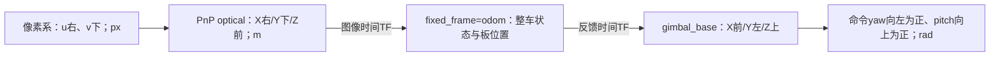

`camera_to_pitch_optical_m=[a,b,c]` 是“光心 → P 轴中心”，表达在相机光学轴中；节点转成“P 轴 → 光心”，表达在俯仰架前/左/上轴中，值为 `[-c,a,b]`。当前 YAML 对应 `[-0.0515,0.06711,0] m`。该参数用于检查外部相机 TF 偏移一致性，不会自动发布 TF。

`pitch_to_barrel_m=[0.0741,0,0]` 是“P轴 → 枪口”，表达在俯仰架坐标系中，用于旋转后的真实枪口弹道计算。两组偏移的原点、轴向和用途不同。

`/target/state` 的 pose/twist 均采用固定系，`child_frame_id` 也填写固定系；并不广播一辆目标车的 TF。未估计的 roll/pitch 相关对角协方差设置为大值。

## 9. Web、离线工具和测试文件

### 9.1 Web 内部函数与数据传递

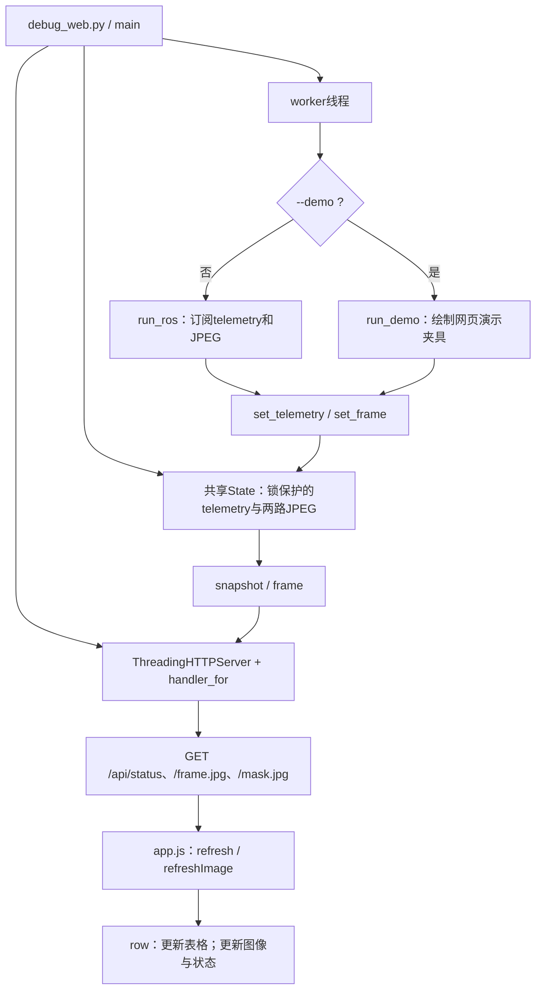

| 文件 | 入口 / 主要函数 | 功能 |
|---|---|---|
| `debug_web.py` | `main()` | 参数解析、资源检查、启动线程与服务、退出清理 |
| 同文件 | `State.set_telemetry()` / `snapshot()` | JSON 校验、存储、按单调时钟判定2秒在线窗口 |
| 同文件 | `State.set_frame()` / `frame()` | JPEG字节存取 |
| 同文件 | `handler_for()` → `Handler.do_GET()` / `send()` | 白名单静态文件、状态 JSON、两路 JPEG；POST 返回405 |
| 同文件 | `run_ros()` / `run_demo()` | 真实 ROS 桥 / 独立 UI 夹具 |
| `web/app.js` | 顶层 `refresh()` | 拉取状态、更新 DOM；完成后100ms再次调度 |
| 同文件 | `refreshImage()`、`row()`；格式化辅助函数 | JPEG fetch、Blob URL更换、表格与数值格式化 |
| `web/index.html` | 浏览器加载 | 布局、图像容器、指标与数据表，加载CSS/JS |
| `web/style.css` | 浏览器样式解析 | 页面视觉样式，无算法函数 |

当前网页没有订阅 `/control/status`、`/target/state` 或 `/gimbal/trajectory`。页面看到“yaw/pitch”是视觉 PnP 的相机方位角，轨迹速度是 px/s，不能当作控制命令或整车速度。

### 9.2 工具、模型、文档与验证入口

| 文件 / 目录 | 入口与作用 |
|---|---|
| `tools/calibrate_camera.py` | `main()`：棋盘格图片 → `findChessboardCornersSB` → `calibrateCamera` → 基于模板输出完整感知YAML；参数 `--images/--cols/--rows/--square-m/--output`；至少6个有效视角 |
| `tools/check_workspace.py` | `main()`：Python AST、包XML、模型哈希/标签、部分配置与OpenCV模型推理检查；**不检查C++能否编译** |
| `tools/smoke_ros.py` | `main()`：视觉ROS与HTTP集成冒烟入口 |
| `tools/smoke_control.py` | `main()`：启动合成视觉+mock，观察位姿与至少10次轨迹，检查点数、数值和加速度约束 |
| `tools/build.sh` | shell顶层：加载ROS环境 → `colcon build` |
| `tools/test.sh` | shell顶层：colcon测试、结果、Web单测、静态资源检查 |
| `tools/install_deps.sh` / `requirements.txt` | 开发依赖安装与Python依赖列表 |
| `tools/preview_web.ps1` / `.sh` | Web界面夹具预览，不运行C++感知 |
| `tools/Dockerfile` | 容器构建与验证环境入口 |
| `src/rm_aa_vision/test/test_perception.cpp` | GTest：预处理、检测、PnP、模型、像素跟踪 |
| `src/rm_aa_control/test/test_control.cpp` | GTest：几何指向、EKF、选板、MPC、弹道；当前含include拼接异常 |
| `tests/test_web.py` | `unittest`：HTTP与状态等Web行为 |
| `src/rm_aa_vision/models/mlp.onnx` / `label.txt` | 模型权重与类别顺序；无程序入口 |
| `README.md`、`docs/architecture.md`、控制包README | 历史设计与使用说明；部分内容未追上当前源码 |
| `output/` | 既有构建、依赖和日志产物；不属于本项目手写业务流程，不代表当前源码已验证 |

`mock_gimbal.py` 的 `MockGimbal.__init__()` 发布静态坐标链，`tick()` 每20ms发零位反馈；它不订阅轨迹，不会根据控制命令转动，不构成物理闭环仿真。

## 10. 当前主要配置参数

下面列出仓库当前 YAML 值，不等于已运行节点的在线参数。启动参数、ROS参数覆盖和外部 CameraInfo 都可能影响最终取值。两个节点除 `use_sim_time` 外的参数均按启动时读取，运行时修改回调会拒绝，需改配置后重启。

### 10.1 感知：`src/rm_aa_bringup/config/perception.yaml`

参数命名空间：`perception.ros__parameters`。

| 参数 | 当前值 | 影响 |
|---|---|---|
| `opencv_threads` | 2 | OpenCV内部线程数 |
| `source.mode` | synthetic | synthetic/camera/video/topic |
| `source.device` | `"0"` | 相机索引或设备路径 |
| `source.video_path` | 空字符串 | 视频文件位置 |
| `source.width / height` | 1280 / 720 | 合成分辨率或相机请求分辨率 |
| `source.fps` | 60.0 | 请求/名义帧率，不是实测保证 |
| `source.loop_video` | false | 视频末尾是否回到开头 |
| `source.frame_id` | camera_optical_frame | 本地采集图像坐标系 |
| `source.image_topic` | /camera/image_raw | topic模式图像入口 |
| `source.camera_info_topic` | /camera/camera_info | topic模式标定入口 |
| `preprocess.brightness_threshold` | 100 | 灰度二值化阈值；0～255 |
| `preprocess.opening_radius` | 0 | 0关闭；否则核边长2r+1，允许0～5 |
| `detector.own_color` | red | 己方色；默认识别蓝灯 |
| `detector.min_light_length` | 8.0 px | 最小灯长 |
| `detector.max_light_width_ratio` | 0.45 | 最大灯宽/灯长 |
| `detector.max_tilt_deg` | 35.0° | 灯条相对竖直的最大倾斜 |
| `detector.min_pair_ratio / max_pair_ratio` | 1.5 / 5.0 | 灯中心水平间距/平均灯长范围 |
| `detector.large_pair_ratio` | 3.3 | 大小板分界 |
| `detector.min_length_ratio` | 0.65 | 两灯短长比下限 |
| `detector.max_vertical_ratio` | 0.6 | 两灯中心高度差/平均灯长上限 |
| `detector.min_color_difference` | 8.0 | 轮廓区域红蓝均值差绝对值下限 |
| `classifier.confidence_threshold` | 0.7 | 分类有效标记门限 |
| `dimensions.small_width_m` | 0.135 m | 小板PnP角点几何宽度 |
| `dimensions.large_width_m` | 0.225 m | 大板PnP角点几何宽度 |
| `dimensions.height_m` | 0.055 m | 灯条端点之间对应高度 |
| `calibration.calibrated` | false | 默认禁止真实相机/视频PnP |
| `calibration.width / height` | 1280 / 720 | 标定对应图像分辨率 |
| `calibration.k` | `[1000,0,640, 0,1000,360, 0,0,1]` | 3×3内参展开；当前为示例值 |
| `calibration.d` | `[0,0,0,0,0]` | 畸变系数；当前为示例值 |
| `pnp.max_reprojection_px` | 3.0 px | IPPE重投影RMSE上限 |
| `image_tracker.association_px` | 80.0 px | 像素KF关联距离 |
| `image_tracker.timeout_s` | 0.3 s | 像素轨迹超时 / 大时间间隔重置 |
| `debug.fps` | 10.0 Hz | 遥测和调试图节拍，非观测话题节拍 |
| `debug.jpeg_quality` | 75 | JPEG编码质量 |

另有节点声明但 YAML 未显式写出的 `classifier.model` 与 `classifier.labels`，默认指向安装包 `models/mlp.onnx` 和 `models/label.txt`。

### 10.2 控制基础与弹道：`src/rm_aa_bringup/config/control.yaml`

参数命名空间：`camera_control.ros__parameters`。

| 参数 | 当前值 | 影响 |
|---|---|---|
| `fixed_frame` | odom | 整车状态估计坐标系 |
| `gimbal_base_frame` | gimbal_base | 基座坐标系 |
| `camera_frame` | camera_optical_frame | 查询相机光心位置的TF帧 |
| `camera_to_pitch_optical_m` | `[0.06711,0,0.0515]` m | 光心到P轴中心，光学轴表达；配置注释仍标注待确认单位与轴向 |
| `camera_offset_tolerance_m` | 0.005 m | 配置外参与实际TF偏移允许误差 |
| `pitch_to_barrel_m` | `[0.0741,0,0]` m | P轴到枪口，俯仰架轴表达 |
| `ballistics.bullet_speed_mps` | 22.0 m/s | 当前固定弹速 |
| `ballistics.bullet_speed_topic` | /gimbal/bullet_speed | **只存在于YAML，当前未声明读取/未接入订阅** |
| `ballistics.gravity_mps2` | 9.7833 m/s² | 重力常量 |
| `observations_topic` | /observations | PnP输入 |
| `feedback_topic` | /gimbal/joint_states | 关节反馈输入 |
| `yaw_joint / pitch_joint` | gimbal_yaw_joint / gimbal_pitch_joint | 按名称从JointState取两轴 |
| `feedback_timeout_s` | 0.15 s | 反馈时效门限 |
| `observation_max_age_s` | 0.2 s | 接收观测年龄门限 |
| `plate_normal_sign` | 1.0 | 板局部+Z朝内方向符号；只接受±1 |

### 10.3 EKF与选板：前缀 `tracker.`

| 参数 | 当前值 | 影响 |
|---|---|---|
| `plate_count` | 4 | 等间隔板数量；代码允许1～16 |
| `radius_m` | 0.25 m | 半径初值，不是固定半径 |
| `min_radius_m / max_radius_m` | 0.05 / 0.8 m | 更新后的半径可接受范围 |
| `acceleration_variance` | 4.0 | 平移白噪声加速度方差，影响Q |
| `angular_acceleration_variance` | 16.0 | 相位角加速度噪声方差 |
| `position_variance` | 0.0025 m² | 板位置测量方差；各轴标准差0.05m |
| `yaw_variance` | 0.04 rad² | 板法向角测量方差；标准差0.2rad |
| `association_distance_m` | 0.5 m | 板位置关联门限 |
| `association_yaw_rad` | 1.0 rad | 板相位关联门限 |
| `nis_gate` | 18.47 | 4维创新归一化平方距离门限 |
| `timeout_s` | 0.3 s | 最后成功校正后允许短时外推的时长 |
| `switch_margin_m` | 0.05 m | 最近板切换需额外近5cm；0关闭滞回 |

初始 P 对角线 `[0.1,4,0.1,4,0.1,4,0.2,4,0.02]` 和半径噪声系数 `1e-5` 是代码常量，非 YAML 参数。

### 10.4 MPC：前缀 `mpc.`

| 参数 | 当前值 | 影响 |
|---|---|---|
| `horizon` | 25 | 预测点数量 |
| `dt_s` | 0.02 s | 离散时间步，也决定控制定时器周期 |
| `iterations` | 300 | 投影梯度迭代上限 |
| `angle_weight` | 40.0 | 角度误差代价权重 |
| `velocity_weight` | 1.0 | 角速度误差代价权重 |
| `effort_weight` | 0.1 | 角加速度代价权重 |
| `yaw_max_acceleration` | 6.0 rad/s² | yaw角加速度硬上限 |
| `pitch_max_acceleration` | 4.0 rad/s² | pitch角加速度硬上限 |
| `tolerance` | 1e-5 | 投影梯度残差收敛门限 |

### 10.5 Launch参数与覆盖关系

| Launch参数 | 默认值 | 作用 |
|---|---|---|
| `config` | bringup安装目录的 `config/perception.yaml` | 感知配置文件 |
| `source` / `device` / `video` | synthetic / `0` / 空 | 覆盖 `source.mode/device/video_path` |
| `web` | true | 启动HTTP调试桥 |
| `host` / `port` | 127.0.0.1 / 8080 | Web监听地址与端口 |
| `control_config` | bringup安装目录的 `config/control.yaml` | 控制配置文件 |
| `use_sim_time` | false | control.launch明确传给控制节点的时钟参数 |
| `mock_gimbal` | false | tracking.launch开启固定TF与零反馈 |

**容易忽略的覆盖：** 感知 launch 先加载 YAML，再用 `source/device/video` 覆盖。仅修改 YAML 中 `source.mode`，但仍使用默认 launch 参数时，会被 `source:=synthetic` 覆盖。`use_sim_time` 当前明确设置在控制启动文件，不能因此认定视觉和mock自动同步使用模拟时间。

## 11. 当前源码状态与流程阻塞

这些是本次阅读源码发现的实际问题，未在本次分析中修改。

| 位置 | 当前证据 | 对流程的影响 |
|---|---|---|
| `control_node.cpp:10` | 两个include之间存在字面量 `` `n ``，并非换行 | 第二个include未正常形成指令，影响Float64声明与编译 |
| `control_node.cpp:176` | 实际文本为 `transform\(fixed_frame_, camera_frame_, frame_time\)` | C++调用含多余反斜杠，控制节点不能按当前文本正常编译 |
| `test_control.cpp:3` | pointing与ballistic的include之间也有字面量 `` `n `` | 弹道头未正常包含，当前测试构建受影响 |
| `ballistic.hpp:60` 附近 | `flight_time` 初始化为NaN，之后仅在 `candidate_time < flight_time` 时赋值 | 与NaN比较恒为false；可达目标也无法选中候选，抛出 `No positive-time ballistic solution`；即使编译问题解决，规划仍会失败 |
| `control.yaml` 与节点构造 | 有 `bullet_speed_topic` 和订阅成员，但无对应参数声明与 `create_subscription` | 目前使用固定弹速22m/s，没有实时弹速更新 |
| 视觉分类到PoseArray边界 | 未按 `classification_valid` 拒绝PnP；PoseArray无身份质量字段 | 数字分类失败的几何候选仍可能初始化或更新控制跟踪 |
| 外部执行接口 | 只发布 ROS JointTrajectory | 没有串口/CAN协议、发包、CRC、实际云台驱动或开火命令实现 |
| 历史文档 | 控制README仍描述零偏移与几何相机指向等旧状态 | 与当前YAML非零偏移、当前弹道调用不一致，应以本次源码关系为准 |

因此当前项目可准确概括为：**已有完整的视觉感知组织、独立像素跟踪和单车EKF/MPC源码框架，控制端正在接入弹道与外参；当前源码的控制编译/弹道路径尚有阻塞，硬件发送仍在项目外。**

若按源码阅读顺序理解全工程，建议：`tracking.launch.py` → 两份YAML → `perception_node.cpp` → 六个视觉算法文件 → `types.hpp`和ROS话题边界 → `control_node.cpp` → `tracker.cpp` → `ballistic.hpp` → `mpc.cpp` → `debug_web.py/app.js`。
