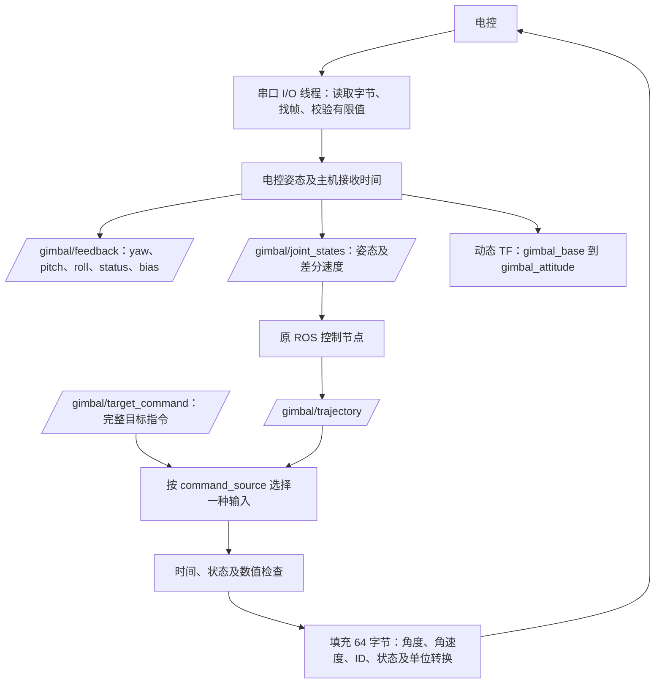

# ROS2 C++ 电控串口桥接

`hardware_node` 将电控的 64 字节反馈转换为 ROS 姿态、关节状态和动态 TF，并将 ROS 目标指令转换回相同的 64 字节协议。它不运行相机、检测、EKF 或 MPC，也不替代下位机的电机闭环。

构建直接使用 `../../training/serialPort/include/Communication.hpp` 和 `SerialPort.cpp`，协议只有一份源定义。无需构建或运行 training 主程序，也不依赖 OpenCV。构建时请保留完整 RM_AA 目录；安装后的节点不需要读取 training 源文件。参考串口代码的来源与许可说明见根目录 `THIRD_PARTY.md`。

## 数据流和接口



| 接口 | 类型 | 内容 |
|---|---|---|
| `/gimbal/feedback` | `rm_aa_hardware/msg/GimbalFeedback` | yaw/pitch/roll，估计速度及有效标志，status、is_far、bias |
| `/gimbal/joint_states` | `sensor_msgs/msg/JointState` | 默认 yaw、pitch、roll 三个关节；原控制节点读取 yaw/pitch，附加 roll 用于相机偏移检查 |
| `/tf` | TF | `gimbal_base → gimbal_attitude`，随收到的姿态更新 |
| `/gimbal/target_command` | `rm_aa_hardware/msg/TargetCommand` | 原子完整目标指令；仅在 `command_source: target_command` 时订阅 |
| `/gimbal/trajectory` | `trajectory_msgs/msg/JointTrajectory` | 原 MPC 轨迹；仅在 `command_source: trajectory` 时订阅 |
| `/hardware/connected` | `std_msgs/msg/Bool` | 串口是否已打开并配置；不代表反馈仍新鲜 |

话题名可通过 ROS remapping 修改。参数均为启动参数，更改 YAML 后重启；真实串口模式拒绝 `use_sim_time=true`。

## 接收反馈与 TF

协议 `yaw/pitch/roll` 单位为 rad，沿用 training 的约定：前、左、上坐标轴，yaw 绕 +Z，pitch 向上为正，roll 绕 +X；姿态矩阵为 `Rz(yaw) * Ry(-pitch) * Rx(roll)`。电控必须使用相同零位及正方向。本实现假设姿态相对于 `gimbal_base`；若电控提供绝对 IMU 姿态而底座会独立运动，需先明确参考系，不能直接混用。

协议没有 MCU 时间戳和实际角速度：

- ROS 时间戳为**主机收到完整帧的时间**，不是电控采样或相机曝光时间。
- 角速度用连续姿态的角度差分估计，跨 ±π 归一化。
- 首帧、间隔不足 0.1ms、超过反馈超时的首帧，`velocity_valid=false`，JointState 的 velocity 留空。控制节点会等待有效速度。
- 未用协议 `yaw_vel/pitch_vel` 充当实际反馈；这些是视觉发给电控的目标角速度字段。

默认只发布动态姿态 TF，避免伪造相机标定和底盘里程计。完整坐标链需要：

```text
odom → gimbal_base → gimbal_attitude → camera_optical_frame
       外部里程计      本节点动态TF       实测相机外参
```

固定底座台架可以显式开启 `publish_fixed_base_tf: true`，发布恒等 `odom → gimbal_base`；底盘运动时不要使用该假设。

填写实测 `camera_translation_m` 和 `camera_quaternion_xyzw`，确认 `camera_extrinsics_calibrated: true` 后，可以开启 `publish_camera_tf`，发布 `gimbal_attitude → camera_optical_frame`。平移表示相机光心在随动云台系的位置，旋转表示从相机光学系到随动云台系的旋转。也可让外部 TF 节点发布这条边，不能重复发布。

相机平移必须与 `control.yaml` 中的 `camera_to_pitch_optical_m=[a,b,c]` 对应的 `[-c,a,b]` 一致，否则控制节点报告 `camera_tf_mismatch`。原控制器仍为 yaw/pitch 双轴控制器；新增 roll 反馈用于坐标与偏移一致性检查，不增加 roll 电机控制或完整三轴弹道模型。

## 发送指令的两种模式

### 完整目标指令（默认）

`command_source: target_command` 订阅 `/gimbal/target_command`。生产者必须提供非零、不过期的 `header.stamp`，`header.frame_id: gimbal_base`，以及正确目标 ID、跟踪状态和目标角度。原 `control_node` 当前发布 JointTrajectory，**尚不产生这条完整目标消息**。

| ROS 字段 | 串口字段 / 单位 |
|---|---|
| `target_yaw/target_pitch` | 同名字段，rad |
| `yaw_velocity/pitch_velocity` | `yaw_vel/pitch_vel`，rad/s |
| `target_id` | `armor_flag`，0 表示无目标 |
| `tracking_state` | `crc`，0 无目标 / 1 稳定 / 2 未稳定，不计算 CRC 校验和 |
| `distance_m` | `distance`，m |
| `center_x_m/center_y_m` | `coo_x/coo_y`，乘以 1000 转为 mm |
| `processing_latency_ms` | `latency`，加上从消息时间戳到发送取样的等待时间，ms |
| `fire_allowed` | 只有 `enable_fire=true`、状态稳定且反馈/指令有效时才置 `fire_allowance=1` |

`header.stamp` 应标记生产者发布结果的时刻；`processing_latency_ms` 已包含此前的计算耗时，避免重复统计。保留字段 `pitch_offset/wheel_w` 始终为零。最新收到的 yaw/pitch/roll/status/is_far/bias 回填到相应字段。

### 对接现有 ROS MPC 轨迹

将 `command_source` 改为 `trajectory`，设置 `trajectory_target_id` 为台架测试中**已经确认的目标编号**。默认 0 时输出无目标帧；不会猜测编号。该参数是固定编号，不是多目标分类结果。

按 joint_names 匹配 yaw/pitch，不依赖数组顺序。要求每个轨迹点包含 positions、velocities，time_from_start 非负且严格递增；header.stamp 非零且不在未来，frame_id 与 base_frame 一致。收到的新轨迹替换旧轨迹；发送时按当前经过时间在相邻点间插值。第一点晚于 t=0 时，使用接收时的反馈估计 t=0 起点。不反复发送首点，也不把最后一点无限期保留。轨迹结束、消息过期或接收反馈过期均退回无目标。

轨迹消息没有目标身份、距离、车体中心和可信的 EKF 稳定/开火状态，因此此模式：

- ID 来自显式配置；distance/coo_x/coo_y 为 0，表示该模式未提供。
- `crc=2`，`fire_allowance=0`，即使 enable_fire=true 也不开火。
- `latency` 仅为从轨迹时间戳到发送取样的时间，不能代表完整视觉延迟。

若需要自动变化的数字 ID、距离、中心、稳定状态和开火判定，应由上游完整规划输出 `TargetCommand`。不要将任意“收到一条轨迹”解释为 EKF 已稳定。

## 串口与异常处理

固定 64 字节，头 0x71、尾 0x4C，小端 IEEE754 float32，8N1。分包、粘包和干扰字节按滑动窗口恢复；非法姿态/bias 的帧丢弃。协议没有真正的校验和，边界和有限值检查不能识别所有传输误码。

只有单独 I/O 线程持有串口；ROS 回调与它通过互斥锁交换状态。读操作 poll 最长等待 5ms，写超时 20ms，反馈队列上限 32。断开后关闭设备、清空待发指令，按 reconnect_s 重连；新连接必须重新获得有效反馈和新指令，不回放旧轨迹。退出尽力发送一次无目标帧后关闭串口。系统或物理断线时无法保证最后一帧送达，下位机也应执行通信超时处理。

默认发送 100Hz；实际频率受波特率和调度影响。无反馈、反馈超时、指令超时、状态不为0/5、无目标或非法命令时：ID/距离/中心/速度/跟踪状态/开火均清零，目标角保持最后有效反馈角。反馈本身停止发布新样本，不能将旧反馈重新打上新时间戳。

本节点发布 status 和 bias，但不会自动修改视觉节点的敌方颜色，也不会自动将 bias 加进原 ROS 控制器的预测。完整命令的上游须自行处理这些业务语义，桥接层不重复做弹道预测。

## 构建和启动

在 Linux ROS2 Humble 环境、完整 RM_AA 根目录：

```bash
source /opt/ros/humble/setup.bash
colcon build --base-paths src --packages-up-to rm_aa_hardware
source install/setup.bash
ros2 launch rm_aa_hardware hardware.launch.py \
  hardware_config:=$PWD/src/rm_aa_hardware/config/hardware.yaml
```

先填写实际串口设备；只测试姿态接收时无需相机和控制节点。观察：

```bash
ros2 topic echo /gimbal/feedback
ros2 topic echo /gimbal/joint_states
ros2 run tf2_ros tf2_echo gimbal_base gimbal_attitude
```

接入整项目前，在配置中选择 trajectory 模式和已确认的 ID，并配置完整 TF 与真实相机标定。随后：

```bash
colcon build --base-paths src
source install/setup.bash
ros2 launch rm_aa_bringup bringup.launch.py source:=camera hardware:=true \
  hardware_config:=$PWD/src/rm_aa_hardware/config/hardware.yaml
```

`hardware` 默认 false；与 `mock_gimbal:=true`、`use_sim_time:=true` 互斥。不要同时运行 training 程序占用同一串口/相机。

## 验证

```bash
colcon test --packages-select rm_aa_hardware --event-handlers console_direct+
colcon test-result --verbose
```

包含原生协议测试和 `test_hardware_pty.py`：Linux 伪终端模拟电控，启动真实 C++ 节点，检查分包接收、ROS 反馈和 TF、完整命令发送、轨迹轴名映射、禁止开火和超时回退。测试不访问真实串口设备。

无 ROS 的 Windows/Linux 环境可单独测试协议核心：

```bash
cmake -S src/rm_aa_hardware -B output/hardware-core-build -DRM_AA_HARDWARE_STANDALONE=ON
cmake --build output/hardware-core-build --config Release
ctest --test-dir output/hardware-core-build -C Release --output-on-failure
```

本次 Windows/MSVC 已通过 9 项协议核心测试；当前环境没有可用 ROS2/Linux 运行环境，ROS 节点构建、伪串口集成测试、真实电控与 TF 联调尚未执行。主机接收时间戳和差分速度不能替代硬件时间同步及实测速度。
