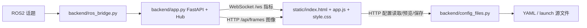

# 监控与参数配置

统一使用原生 HTML/CSS/JS + FastAPI + WebSocket/HTTP，通过 ROS 话题展示视觉、控制和硬件状态。

## 启动

在 `RM_AA` 目录安装 Python 依赖并启动：

```powershell
.\.venv\Scripts\python.exe -m pip install -r src/rm_aa_webUI/requirements.txt
.\src\rm_aa_webUI\run.ps1
```

浏览器打开 `http://127.0.0.1:8080`。仅预览页面时运行 `run.ps1 --demo`，演示指标使用 `demo.` 前缀。

Linux 可以直接运行：

```bash
python3 -m pip install -r src/rm_aa_webUI/requirements.txt
bash src/rm_aa_webUI/run.sh
```

如果系统 Python 禁止 pip 安装，使用 `python3 -m venv --system-site-packages .venv`，激活后安装。ROS 模式需要使用与 ROS 匹配的 Python，并能导入 rclpy 和本工程生成的消息。

ROS 使用原总入口的 `web:=true`，会启动新服务；包名为小写 `rm_aa_webui`，源码目录为 `rm_aa_webUI`：

```bash
colcon build --base-paths src --symlink-install
source install/setup.bash
ros2 launch rm_aa_bringup bringup.launch.py web:=true
# 或仅启动监控桥（业务节点另行启动）
ros2 launch rm_aa_webui webui.launch.py
```

也可手动 `bash src/rm_aa_webUI/run.sh --ros`。同一个端口只启动一份服务。默认监听 `127.0.0.1:8080`；`--host`、`--port` 可修改。服务直接编辑源码配置，需要找到含 `src` 的 RM_AA 目录；可通过 `--workspace` 或环境变量 `RM_AA_WORKSPACE` 显式指定。

## 页面功能

- 指标到达后自动创建曲线：当前值、更新时间、来源筛选、时间窗口、暂停/继续、折叠、清空浏览器历史、单条或全部 CSV 导出。
- 浏览器每指标保留最近 5000 个样本；服务端所有指标共保留最近 10000 个样本。WebSocket 断线后自动重连，补发服务端仍保留的数据；不是长期日志数据库。
- ROS 模式显示检测叠加图和二值图，接收视觉遥测、云台反馈、目标指令、关节状态、跟踪状态和轨迹首点。曲线保留消息原单位，不自动将 rad 转为度。
- 参数页列出 `src/**/config` 中已有的 YAML（含 `.yaml.example`），以及 `src/**/launch/*.launch.py`。支持字段搜索、类型对应输入框、源码编辑、重新加载和保存。
- YAML 表单支持嵌套标量及列表元素，保留未修改内容和注释；支持教学配置的 `%YAML:1.0` / OpenCV 矩阵。launch 表单提取字面量启动默认值及字典常量；表达式通过源码视图修改。解析 launch 使用 AST，不执行脚本。
- 保存前检查语法和文件版本，避免覆盖其他编辑器刚写入的内容。

**保存意味着修改磁盘文件，不会向运行中的节点动态设置参数。** 当前算法大多启动时读取配置，需要重启相关节点。修改的是源码配置；使用复制安装时需重新构建，`--symlink-install` 则应确认实际安装文件为链接。命令行 launch 参数和 launch 内显式覆盖仍优先于 YAML。

## 文件与数据流



| 文件 | 主要入口与职责 |
|---|---|
| `backend/server.py` | `main()`：命令行、源码和静态文件定位、启动 uvicorn |
| `backend/app.py` | `create_app()`：HTTP/WS 路由；`Hub`：带锁的指标和图像缓存 |
| `backend/ros_bridge.py` | `run_ros()`：可选 ROS 订阅线程；`numeric_fields()`：提取数值字段 |
| `backend/config_files.py` | `ConfigFiles`：文件目录/读取/保存；`fields_for()`、`edit_text()`：字段解析和原文局部替换 |
| `static/app.js` | WebSocket 接收、Canvas 曲线、CSV、配置表单与源码编辑 |
| `launch/webui.launch.py`、`run.ps1`、`run.sh` | ROS 与直接运行入口 |
| `tests/` | 服务接口、配置编辑和浏览器验证 |

ROS 默认订阅 `/telemetry`、`/debug/image/compressed`、`/debug/mask/compressed`、`/gimbal/feedback`、`/gimbal/target_command`、`/gimbal/joint_states`、`/target/state`、`/gimbal/trajectory`、`/hardware/connected`。来源分别为 `vision`、`gimbal`、`command`、`joints`、`ekf`、`mpc.first_point`、`hardware`；消息中没有的状态不会被推算补齐。

也可直接向 `POST /api/telemetry` 提交 `{"source":"test","metrics":{"value":1.2}}`，页面自动出现 `test.value` 曲线。完整接口定义见服务自带 `/docs`。
