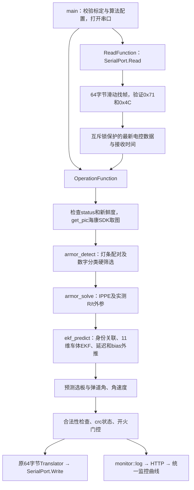

# RMVtraining 适配入口

本目录按用户提供的 `RMVtraining-main/RMVtraining-main` 任务书、双线程框架、通信定义及Web接口适配。算法使用本项目已有的视觉与控制核心；不需要ROS即可运行。原ROS入口继续保留。

## 运行

Linux上安装C++17编译器、CMake、OpenCV4开发包（core/imgproc/imgcodecs/videoio/calib3d/dnn/video）、Eigen3、GoogleTest开发包，以及海康完整MVS开发包。所有模型、Web静态文件随工程保留，不在运行时下载资源。

从 `RM_AA` 根目录：

```bash
cmake -S . -B build-training -DCMAKE_BUILD_TYPE=Release \
  -DRM_AA_WITH_HIKROBOT=ON -DMVS_ROOT=/opt/MVS
cmake --build build-training -j2
ctest --test-dir build-training --output-on-failure

cp training/config/camera.yaml.example training/config/camera.yaml
# 填写真实内外参、图像尺寸和标定误差，完成标定后才能设 calibrated: 1
./build-training/rm_aa_training /dev/ttyACM0 115200 training/config/camera.yaml 8080
```

Web曲线：先按 [WebUI 说明](../src/rm_aa_webUI/README.md) 独立启动 FastAPI 服务，再访问 `http://127.0.0.1:8080`。training 的最后一个参数是指标接收服务的端口，不再启动内部服务器。不使用海康时配置 `-DRM_AA_WITH_HIKROBOT=OFF`，并在相机配置中选择 `source_mode: video` 或 `synthetic`。即使演示输入也不会自动把标定占位值标记为有效。

ROS版本仍用 `bash tools/build.sh`，或 `colcon build --base-paths src --symlink-install`；指定src可以避免colcon将新增根CMake工程作为ROS包发现。独立版本与ROS版本分别构建、分别启动；它们不会自动互连，勿同时占用同一个相机、串口或Web端口。

## 调用流程



主线程组织生命周期；串口读线程只读电控数据；操作线程独占相机、分类器、EKF和发包。指标客户端使用后台 HTTP 线程，FastAPI 服务独立运行。异常、退出、取流连续失败均发送无目标帧并释放资源。

## 协议保持

`serialPort/include/Communication.hpp` 原样保留参考的字段、类型、顺序、1字节对齐和全部偏移断言；帧长64，头0x71、尾0x4C。`crc`仅为状态，不计算CRC。

| 数据 | 内部 / 协议 |
|---|---|
| 电控yaw/pitch/roll | rad |
| 电控bias | s，用作预测时间偏置 |
| latency | 实测本轮操作耗时，ms |
| distance | 预计目标位置到相机的距离，m |
| coo_x/coo_y | 跟踪中心m转换成mm |
| target_yaw/target_pitch | 固定基座参考的绝对指令角，rad |
| yaw_vel/pitch_vel | 预测目标指令角速度，rad/s |
| crc | 0无目标，1稳定，2尚未稳定或短时缺测 |
| fire_allowance | 仅配置开启、当前校正成功、稳定、误差在门限内时为1 |

`status=0`己方红、检测蓝；`status=5`己方蓝、检测红；其他状态回无目标。状态改变时清空跟踪，防止继续追踪原颜色目标。NaN/Inf、帧过期、全体PnP失败、空相机帧、预测超时均回安全帧。短暂检测丢失时向EKF传空观测，可保持短时位置预测，但输出不稳定状态且禁止开火；长期丢失重置。

`enable_fire`默认0。数字1～5直接作为ID；前哨/哨兵/基地的协议ID未在参考中规定，因此默认映射0并拒绝，待与电控确认后填写 `outpost_id/guard_id/base_id`，不擅自约定编号。

## 坐标、尺寸和跟踪

相机：右、下、前。随云台旋转的云台坐标系：前、左、上。实测外参：`p_gimbal = R_camera_to_gimbal * p_camera + t_camera_to_gimbal`，平移为米。

基座固定跟踪系与零位云台轴一致；姿态变换采用 `Rz(yaw)*Ry(-pitch)*Rx(roll)`，pitch向上为正。串口角度必须满足此符号和零位约定。只收到姿态，没有底盘位置，假设基座平移不变；不把底盘运动解释为已补偿。yaw/pitch轴按相交模型处理。

PnP模型尺寸严格使用任务值：小板0.135×0.057m，大板0.230×0.057m。ROS默认尺寸也同步。分类失败或未知编号不进入训练入口PnP/EKF。

11维状态：`[cx,vx,cy,vy,z_even,vz,theta,omega,r_even,r_odd,dz_odd]`。偶数板高度为z_even、半径r_even；奇数板高度为z_even+dz_odd、半径r_odd。默认4板，交替几何要求偶数板数。具备角度跨界、空间/角度关联、NIS门控、Joseph协方差更新和超时重建。

同一跟踪期间锁定数字ID；同ID多板按几何关联，超时后才允许换车。没有多车同时跟踪；多个相同ID的相邻目标仍可能混淆。

预测起点包含从帧取得到当前的实测处理时长，以及电控bias。按该时刻预测距离选板，加5cm切换滞回；所选板使用飞行时间迭代预测，8次不收敛则拒绝。目标角速度用未来10ms角度差分，跨±π归一化。直接输出预测参考，不经过ROS版本MPC，避免把未收到的关节速度当成反馈。

稳定要求连续成功更新、位置与相位协方差低于配置门限；单块静止板的中心与半径存在可观测性限制，不能保证仅凭帧数就稳定。短时缺测清零连续稳定计数。bias导致预测时刻早于当前观测，或超过配置最大预测窗时拒绝结果。

## 配置与材料

独立入口使用 `training/config/camera.yaml`（OpenCV YAML），与ROS参数YAML格式不同；模型路径相对于配置文件目录解析。模板包含内参、畸变、完整外参矩阵、相机曝光增益、模型路径、跟踪稳定门限、弹道参数和开火门限。

程序检查标定标志、矩阵形状、有限值、正焦距、旋转正交性和行列式，不伪造标定数据。真实标定图片、误差报告、序列号及MCU轴向约定仍须根据实物测量填写。

串口沿用参考工程的本机浮点内存布局，部署双方应使用 IEEE754 float32 和相同的小端字节序。帧时间记录在取图返回时，云台姿态来自本轮开始复制的最新控制器快照；当前没有曝光硬件时间戳同步、历史姿态插值或底盘平移补偿，`bias` 也不能替代这类同步。

对照任务书的入口对应关系：

| 要求 | 实现入口 |
|---|---|
| 初始化、两条业务线程与退出 | `training/main.cpp`：`main`、`ReadFunction`、`OperationFunction` |
| 海康取图、检测与数字分类 | `training/src/StudentTasks.cpp`：`get_pic`、`armor_detect`，复用视觉核心 |
| 大小板 PnP 与外参 | `armor_solve` → `rm_aa::PoseSolver::solve` |
| 旋转车体、关联、遮挡预测 | `ekf_predict` → `rm_aa_control::Tracker::update` / `plate_at` |
| 64 字节收发和输出校验 | `serialPort/`、`AppSupport.cpp`：`applyPrediction` / `setSafeOutput` |
| 本地 Web 曲线 | `src/rm_aa_webUI/` 与 `monitor::log(key,value)` |

实机验证时，依次记录串口字段及状态、连续取流和断流、大小板数字及PnP误差、平移/旋转/切板、遮挡恢复、Web刷新和SIGINT正常退出。统一页面保留自动标量曲线、暂停、CSV 等功能并增加配置编辑；training 当前仅发送指标，图像通道由 ROS 桥提供，检查时避免同时占用相机。

本项目没有自动完成作业验收；构建和单元测试不能替代实机连续取流、真实串口、板切换与遮挡测试。具体本次验证结果见 [验证记录](../docs/validation.md)。
